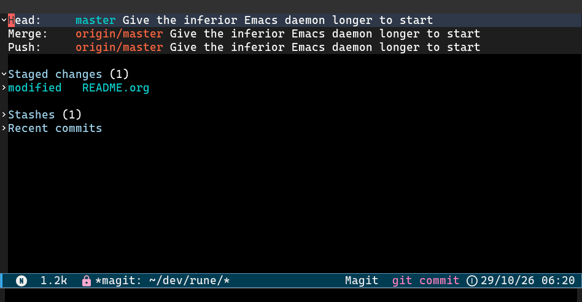

# commit-butler

A transient menu that helps writing [Conventional Commits](https://www.conventionalcommits.org)
messages for you, starting with the type/scope, the `<type>(<scope>)!: ` part of the message:

```
<type>(<scope>)!: <description>
```



## Installation

Requires Emacs 28.1, transient 0.7.0 and yasnippet 0.14.0 or later.

### straight.el

```elisp
(straight-use-package
 '(commit-butler :host github :repo "lattarov/commit-butler"
                 :files ("*.el" "snippets")))
```

### Doom Emacs

```elisp
;; packages.el
(package! commit-butler
  :recipe (:host github :repo "lattarov/commit-butler"
           :files ("*.el" "snippets")))
```

## Configuration

```elisp
(use-package commit-butler
  :hook (git-commit-setup . commit-butler-mode)
  :config (commit-butler-snippets-initialize))
```

## Usage

In a commit message buffer, `C-c ,` opens `commit-butler-menu`:

| Key        | Action                                           |
|------------|--------------------------------------------------|
| type keys  | select the commit type (see `commit-butler-types`) |
| `o`        | set the scope                                    |
| `!`        | mark a breaking change                           |
| `RET`      | insert the message at point                      |

The top of the menu previews the header. `C-x s` and `C-x C-s` set or
save the choices, as in any transient menu.

#### Example: a `Signed-off-by:` footer

```
# -*- mode: snippet -*-
# name: Conventional Commit
# expand-env: ((type "feat") (scope nil) (breaking nil))
# --
`type``(and scope (format "(%s)" scope))``(and breaking "!")`: $1

$2

`(and breaking "BREAKING CHANGE: ")`$0
Signed-off-by: `user-full-name` <`user-mail-address`>
```

The sign-off follows the last field, so footers typed there, such as
`Refs: #123`, end up in the same block. For `fix(parser)`, the message
reads:

```
fix(parser): handle empty input

Return nil instead of signaling an error.

Refs: #123
Signed-off-by: Jane Doe <jane@example.com>
```


## License

GPL-3.0-or-later. See `LICENSE`.
